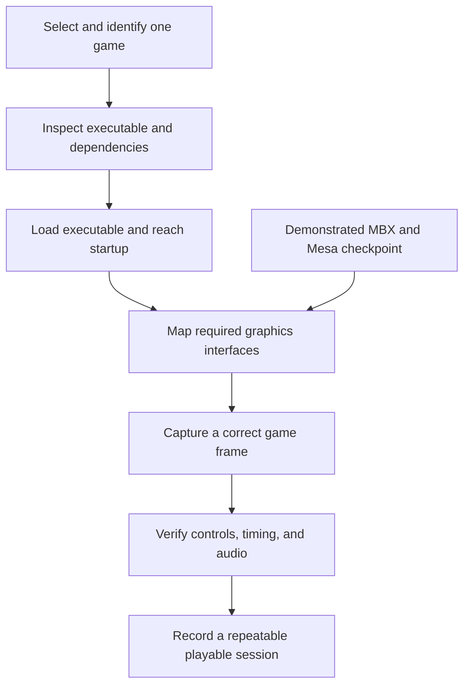

# Development roadmap

These investigations concern future work. Each begins with evidence from the existing implementation and has a specific question to resolve.

| Investigation | Existing foundation | Evidence needed before changing the design |
| --- | --- | --- |
| Reduce window-movement cost | Retained cell planes and damage tracking in the host. | Measure which planes rebuild, how many cells are composed, and output bytes during a repeatable drag. Compare static and animated backgrounds. |
| Preserve responsive interaction under load | Calibrated input, process acquisition, native buffering, and Touch lab. | Correlate event timestamps, desktop dispatch, and visible response. Record connection state and background workload with the capture. |
| Render cells with the N810 GPU | Cell-based application interfaces and the separate MBX/Mesa checkpoint. | Demonstrate glyph/color drawing, clipping, overlapping windows, and presentation on the actual device; compare total cost with the console path. |
| Support richer imagery inside windows | Prepared map surfaces and cell-based controls. | Specify coordinate mapping, stacking, terminal fallback, memory limits, and how a pixel surface shares a window with cells. |
| Reduce idle work | Shared owners, subscriptions, and change-driven rendering. | Attribute CPU use to the desktop and each owner with Local-only and connected configurations. |
| Complete source lineage | Kernel locks, component import records, licenses, and Git history. | Record upstream path/revision, modifications, and supporting development records per component. Mark unresolved human/LLM attribution explicitly. |

The [architecture](explanation/architecture.md), [rendering explanation](explanation/rendering.md), and [touch-acquisition record](pocket/touch-acquisition.md) describe the current foundations. The [journal](journal.md) records the progression and its measured results.

## Run selected Symbian games on Linux

The goal is to play selected older Symbian games on the N810 through a compatibility layer integrated with the Linux system. Each game's actual dependencies define the initial scope. Pocket supplies the surrounding desktop; the compatibility work supplies the executable and service behavior required by the chosen game.

### Demonstrated graphics foundation

The [MBX bring-up journal](posts/2026-11-03-mbx-rendering.md) describes getting standard glxgears rendering through Mesa and X11. The [following performance investigation](posts/2026-11-04-gpu-performance.md) records two physical-device runs at 30.78 and 30.63 completed GPU FPS after moving the gears' transformation and lighting onto the VGP. The [driver build and test guide](how-to/build-gpu-30fps.md) links the frozen implementation, build inputs, and regression tests.

Those results establish a hardware-accelerated graphics foundation for investigating game compatibility. Their measurements apply to the documented gears workload and presentation path. A game's executable loading, graphics calls, input, audio, and timing require their own evidence.

### Progress recorded on 7 November 2026

The compatibility investigation now has native ARM execution and two real application targets: ChessGenius and Snakes. The experimental runtime has exercised GPU clear and composition operations. Both applications still need accepted visible UI, working controls, and sustained execution through the same GPU-backed runtime.

The next graphics work concerns persistent drawing surfaces, texture dimensions, clipping, masking, and resource lifetime. Driver probes establish individual operations; application acceptance follows the complete path from executable startup to visible interaction. These candidates remain under development outside the published MBX checkpoint. The published build guide identifies the reproducible driver source currently shipped here.

### Remaining compatibility work

Begin with one legally obtained game whose executable format, CPU requirements, imported libraries, and graphics API can be identified. Record the exact game version and relevant dependencies. Hardware compatibility must be checked against that target: a shared CPU instruction set or related graphics processor provides useful overlap, while the software interfaces still determine what the executable expects.

Implement the interfaces needed to reach successive observable milestones. For asynchronous requests, document completion, cancellation, errors, and callback ordering as the game observes them. Choose Linux implementation mechanisms after establishing those requirements. Preserve the existing system architecture while supplying the behavior needed by the target application.

*The game milestones describe proposed work. The MBX checkpoint is the existing measured result linked above.*

Record progress separately for executable startup, a correct rendered frame, working controls, working audio, and sustained play. Each result should identify the source revision, game version, hardware, configuration, and observed limitations. Publish technical findings and permitted captures with links to the corresponding implementation and tests. Keep unverified compatibility expectations in this roadmap until a reproducible result supports a journal entry.

## Recording follow-up: desktop previews and background clearing

The isolated laptop captures made on 6 November exposed two visible issues. Some Settings icons become question marks in the overview, and Station Map thumbnails can contain the header with an empty map area. Compare each miniature with its source cell plane, including half-block terrain and icon glyphs, and verify that previews update when asynchronous map work completes.

The background-off step in the overview tour leaves visible glyphs on desktop 3. Trace the toggle through background state, damage tracking and terminal output. Acceptance requires a cleared desktop after switching the background off, followed by a correctly redrawn effect when it is enabled again. These observations are from the local documentation checkpoint; implementation and device validation remain future work.

## Map previews and selected-area downloads

The retained-map resize correction and selective elevation sampling are recorded in the [7 November journal entry](posts/2026-11-07-map-resizing.md). Further work is to measure cold preparation and refinement on the Nokia, choose a device detail budget, and inspect pan, zoom, clipping, and input under load.

Area selection currently uses the [map build commands](how-to/build-map-data.md) and saved configuration. An integrated area-and-layer download pane still needs progress reporting, cancellation, cache reuse, and a clear estimate of the requested data size. Fine elevation remains available to analysis while locally derived overviews serve display work.
