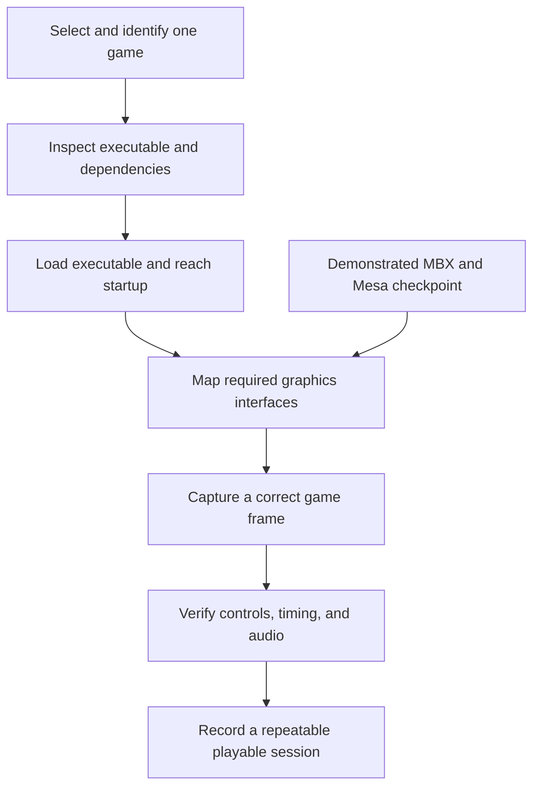

# Development roadmap

These investigations concern future work. Each begins with evidence from the existing implementation and has a specific question to resolve.

| Investigation | Existing foundation | Evidence needed before changing the design |
| --- | --- | --- |
| Reduce window-movement cost | Retained cell planes and damage tracking in the host. | Measure which planes rebuild, how many cells are composed, and output bytes during a repeatable drag. Compare static and animated backgrounds. |
| Preserve responsive interaction under load | Calibrated input, process acquisition, native buffering, and Touch lab. | Correlate event timestamps, desktop dispatch, and visible response. Record connection state and background workload with the capture. |
| Extend direct pixel scenes | Integrated native frontend, direct Room pixels, and ordered window overlays. | Validate more apps, resource lifetime, and physical Nokia behavior while preserving terminal views. |
| Reduce idle work | Shared owners, subscriptions, and change-driven rendering. | Attribute CPU use to the desktop and each owner with Local-only and connected configurations. |
| Complete source lineage | Kernel locks, component import records, licenses, and Git history. | Record upstream path/revision, modifications, and supporting development records per component. Mark unresolved human/LLM attribution explicitly. |
| Run selected ARM Windows CE applications | Native ARM execution and managed display handoff from the Symbian runtime. | Load an independently authored ARM CE executable, resolve its imports, intercept its system requests, and verify output and clean exit on the N810. |

The [architecture](explanation/architecture.md), [rendering explanation](explanation/rendering.md), and [touch-acquisition record](pocket/touch-acquisition.md) describe the current foundations. The [journal](journal.md) records the progression and its measured results.

## Run selected Symbian games on Linux

The goal is to play selected older Symbian games on the N810 through a compatibility layer integrated with the Linux system. Each game's actual dependencies define the initial scope. Pocket supplies the surrounding desktop; the compatibility work supplies the executable and service behavior required by the chosen game.

### Demonstrated graphics foundation

The [MBX bring-up journal](posts/2026-11-03-mbx-rendering.md) describes getting standard glxgears rendering through Mesa and X11. The [following performance investigation](posts/2026-11-04-gpu-performance.md) records two physical-device runs at 30.78 and 30.63 completed GPU FPS after moving the gears' transformation and lighting onto the VGP. The [driver build and test guide](how-to/build-gpu-30fps.md) links the frozen implementation, build inputs, and regression tests.

Those results establish a hardware-accelerated graphics foundation for investigating game compatibility. Their measurements apply to the documented gears workload and presentation path. A game's executable loading, graphics calls, input, audio, and timing require their own evidence.

### Progress recorded on 6–7 November 2026

[Native ChessGenius execution](posts/2026-11-06-native-symbian.md) reached a visible board and completed d2-d4 followed by the game's e7-e6 reply on the N810. That milestone used CPU softpipe rendering. Its later run reduced startup to the first partial UI and completed graphics teardown after a requested stop.

The [subsequent GPU investigation](posts/2026-11-07-symbian-surfaces.md) has exact physical-device results for selected clear, retained-surface, scissor, and large-texture operations. ChessGenius and Snakes both execute native ARM code and reach GPU jobs. Complete GPU-backed application UI, controls, and sustained execution remain pending. The driver candidates and runtime have yet to become a public reproducible compatibility checkpoint.

### Remaining compatibility work

Continue with the identified ChessGenius and Snakes targets, retaining their executable identities and dependencies in the test records. Hardware compatibility must be checked against that target: a shared CPU instruction set or related graphics processor provides useful overlap, while the software interfaces still determine what the executable expects.

Implement the interfaces needed to reach successive observable milestones. For asynchronous requests, document completion, cancellation, errors, and callback ordering as the game observes them. Choose Linux implementation mechanisms after establishing those requirements. Preserve the existing system architecture while supplying the behavior needed by the target application.

*Native loading and one software-rendered game interaction have been demonstrated. The remaining GPU application milestones build on the physical driver results linked above.*

Record progress separately for executable startup, a correct rendered frame, working controls, working audio, and sustained play. Each result should identify the source revision, game version, hardware, configuration, and observed limitations. Publish technical findings and permitted captures with links to the corresponding implementation and tests. Keep unverified compatibility expectations in this roadmap until a reproducible result supports a journal entry.

## Run selected ARM Windows CE applications on Linux

The [10 November design investigation](posts/2026-11-10-windows-ce-runtime.md) proposes a second compatibility runtime. It would follow the Symbian runtime's broad arrangement: load a guest executable and its libraries, run ordinary ARM instructions on the N810 CPU in an isolated Linux worker, dispatch guest operating-system requests through a supervised boundary, and return drawing and input through Pocket's session and display path. No Windows CE application has run through this proposed path.

Start with a tiny, independently authored ARM Windows CE 3 program with known imports and expected output. It should call only a few `COREDLL` exports, report a recognizable result, and exit; this isolates loading and service dispatch before window behavior. A PE loader must map sections at the required address or apply available relocations, resolve DLL names and exports, set up the guest stack and thread state, and reject unsupported binaries. Begin with a small CE-facing `coredll` implementation backed by Linux services. Test loading a matching original `coredll.dll` only as a separate experiment: its wrappers still expect CE kernel and service behavior. CE 3, 4.x, and 5.x need explicit compatibility profiles rather than an assumed common ABI.

The first fixture should be a small source-controlled program and a repeatable build, with no graphical interface or application data. Record its target CPU, CE version, PE image base, sections, imports, and expected result. First verify the built PE's headers and imports, then use it to check native ARM entry, one observable `COREDLL` call, and clean process exit. A second tiny window fixture can check messages and basic GDI before SpreadCE. The toolchain, exact imports, and output channel remain to be selected when implementation begins.

The memory model needs a guest `VirtualAlloc` and mapping manager for the 32 MB private-process layout, shared allocations, protection changes, and address collisions. The N810's 32-bit ARM kernel uses 4 KB pages; the CE KData and trap addresses in the upper address range cannot simply be mapped as Linux user pages. Identify the target program's actual KData, thread-local, and trap accesses before choosing direct shims, instruction handling, or controlled fault interception. Keep intentional guest traps distinct from genuine faults. Full structured exception handling belongs to the compatibility work for applications that require it.

Advance through separately checked milestones: loader and import resolution; native ARM execution with a small set of calls; files, handles, threads, and timers; a message loop and basic GDI window; then the first real application, SpreadCE. The locally supplied SpreadCE executable is a 5.9 MB ARM CE 3 PE with a preferred base of `0x10000`, stripped relocations, an exception directory, and imports from `COREDLL.dll`, `commctrl.dll`, `commdlg.dll`, and `WININET.dll`. Its fixed base and broad UI imports make it a poor loader diagnostic, but its ordinary spreadsheet workflow gives a concrete application goal: open a blank sheet, edit a cell, save and reopen it, and exit cleanly. Check each stage on a host and on the N810 separately; no CE runtime or N810 execution is claimed here.

PocketDOS's ARM CAB is a later target: its DOS emulator adds work beyond CE. The BE-300 build is MIPS and needs a separate CPU path. A local 56 KB ARM CE 2.11 MPEG player is smaller than SpreadCE, but playback, sound, and the older CE profile make it a less useful first application test.

We'll publish runtime and harness source, not app binaries. Testers can get SpreadCE from [Bye Design's version page](https://www.byedesign.co.uk/versions.htm) (HPC 2000 ARM); the [Entertainment Pack evaluation CD](https://archive.org/details/cd-rom_20240105) and [Entertainment Pack 2 CD](https://archive.org/details/EntPack2WinCE) are other CE software sources. Check each program's CPU before testing it.

[WCECL](https://github.com/gweslab/wcecl) illustrates a replacement `COREDLL`, but targets x86 applications on desktop Windows and is archived. [CERF](https://github.com/gweslab/cerf) and [MAME](https://docs.mamedev.org/initialsetup/mameintro.html) are hardware-emulation references, not native ARM runtime bases. Review the exact revision and license before reusing any code. First acceptance is the authored fixture reaching expected output and clean exit through the native worker; SpreadCE's edit and save workflow is the next application-level result. A PocketDOS screen, working controls, and usable speed are later, independent results.

## Recording follow-up: desktop previews and background clearing

The isolated laptop captures made on 6 November exposed two visible issues. Some Settings icons become question marks in the overview, and Station Map thumbnails can contain the header with an empty map area. Compare each miniature with its source cell plane, including half-block terrain and icon glyphs, and verify that previews update when asynchronous map work completes.

The background-off step in the overview tour leaves visible glyphs on desktop 3. Trace the toggle through background state, damage tracking and terminal output. Acceptance requires a cleared desktop after switching the background off, followed by a correctly redrawn effect when it is enabled again. These observations are from the local documentation checkpoint; implementation and device validation remain future work.

## Map previews and selected-area downloads

The retained-map resize correction and selective elevation sampling are recorded in the [7 November journal entry](posts/2026-11-07-map-resizing.md). Further work is to measure cold preparation and refinement on the Nokia, choose a device detail budget, and inspect pan, zoom, clipping, and input under load.

Area selection currently uses the [map build commands](how-to/build-map-data.md) and saved configuration. An integrated area-and-layer download pane still needs progress reporting, cancellation, cache reuse, and a clear estimate of the requested data size. Fine elevation remains available to analysis while locally derived overviews serve display work.

## Native graphical desktop and interactive scenes

The [native Mac desktop](posts/2026-11-07-native-desktop.md) runs the shared application registry and desktop model, consumes packed composition batches, and draws Surface Room directly at window pixel resolution. [Target-range interaction](posts/2026-11-07-surface-room.md) adds movement, aiming, hit state, and reset. The later [GPU provider](posts/2026-11-07-gpu-effects.md) has exact-output comparisons for windows, Flux, Flurry, Station Map, and terrain.

The next work follows the remaining boundaries in those tests:

- Extend the integrated build checks with the remaining experimental exact-output comparisons. The platform inputs now build from a fresh checkout through the [graphical frontend Makefile targets](pocket/graphics.md).
- Bring the target-range acceptance checks into the integrated desktop, including capture release, focus loss, hits, reset, and restored graphics state.
- Resolve the application-view notification warning seen at the end of the combined GPU run, then verify session save and restore.
- Compare CPU and GPU paths with identical scene inputs, dimensions, quality, warmup, and frame counts. Include preparation, precision repairs, readback, composition, and presentation in the accounting.
- Reduce copies and GPU readback where the platform permits, with image comparisons and buffer-lifetime checks before changing the default.
- Validate direct scene pixels, transparency, and mixed GPU state on the physical N810. Ordinary desktop text now uses native C cell rasterization, with calibrated process-owned touch; GPU scene acceptance remains separate from that desktop baseline.

Moving projectiles would extend the current immediate ray-based target test with travel time and collision over simulation steps. That remains a possible scene extension, separate from the implemented hit/reset behavior.
