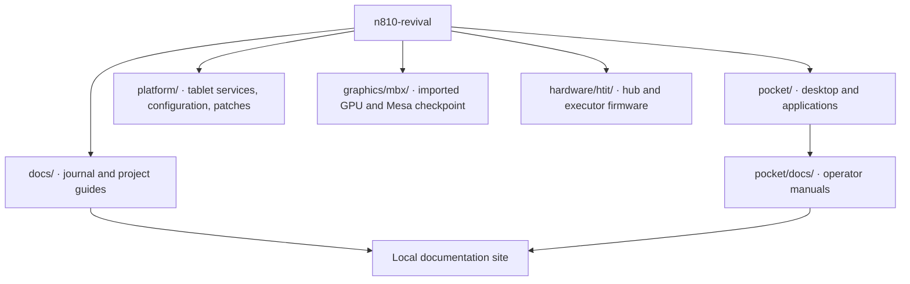

# Source map

*The site builds the Pocket manuals directly from the documentation beside the code.*

| Directory | Responsibility |
|---|---|
| `pocket/` | Terminal desktop, applications, service adapters, tests, and Nokia packaging. |
| `platform/scripts/` | N810 operating-system commands and local source tests. |
| `platform/device/` | Service definitions, keymaps, and policy files intended for the tablet filesystem. |
| `platform/patches/` | Reviewed source patches, beginning with the [RGB console extension](reference/console-rgb-patch.md). |
| `platform/kernel/` | Maintained kernel source delta, configuration, pinned inputs and Linux builder. |
| `platform/config/` | Configuration templates and package lists. |
| `hardware/htit/` | Hub and executor firmware, vendored libraries, board settings and tests. |
| `graphics/mbx/` | Imported GPU module, Mesa integration, encoder source and tests. |
| `pocket/data/` | Local map downloads and generated tiles (ignored by Git); see the map build guide. |
| `historical/` | Earlier sidebar, phone-terminal and CPU/DSP source with build inputs and tests. |
| `platform/console-rgb/` | Retained console implementation and sanitizer regression harness. |
| `platform/maemo/` | Maemo helper emulator and synthetic flash-reader tests. |
| `docs/` | Journal, guides, reference, and architecture explanations. |
| `tools/` | Publication checks, site assembly, and reproducible documentation fixtures. |

Pocket includes earlier domain code that its current applications import. The [bundled-source map](reference/bundled-source.md) explains packet-console, app domains, terminal dependencies, and Map Library resources. Regional maps, elevation tiles, scene data and prepared previews are included with their source metadata.

The platform runtime has its own [file map](reference/platform-files.md). Pocket's `platform/n810/` adapter packages the application for an existing Nokia supervisor. The top-level platform directory holds the OS-side components underneath it.

The [kernel guide](how-to/build-kernel.md) reconstructs the maintained kernel from the included changes and pinned upstream source. The [graphics build guide](how-to/build-gpu-30fps.md) selects the tested 30 FPS MBX/Mesa source and runs its regression checks.

The [chronological journal source index](reference/journal-sources.md) connects every post to local source views, GitHub files, tests and build guides.

## Kernel lineage and authorship

The kernel build starts from Linux 5.15.224. The included [source lock](https://github.com/gordol/n810-revival/blob/main/platform/kernel/source.lock.json) records upstream commit `700e62ea909a70b9f72692d8b7a192ac7ebde0aa`, maintained commit `6bd43ee8d27b207c958808368251d55ec0475f9e`, the kernel.org archive URL, and its SHA-256. The build applies the maintained source delta and configuration to that upstream input.

The RGB console changes extend Linux's existing virtual-terminal and framebuffer-console implementation. The changed upstream files retain their upstream authorship and licensing; the patch identifies the project modifications. A file can contain contributions from many people over time. Its copyright notices, upstream history, and individual changes provide complementary evidence about that history.

Git records commits and their stated authors and committers. Those fields alone cannot establish whether a particular passage was typed by a person, produced with an LLM, copied from a reference, or adapted during review. A complete account of those methods requires retained development records and comparison with the source being reused. The source locks and import manifests establish specific checkpoints; a repository-wide, per-file account of human and LLM contributions remains to be assembled.
