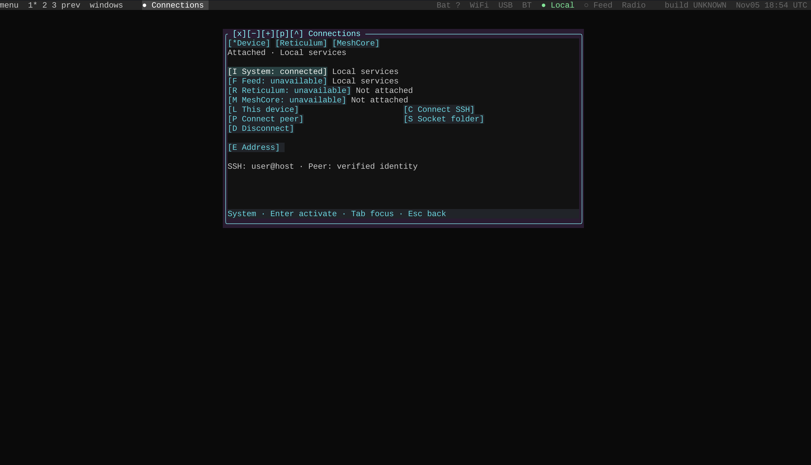
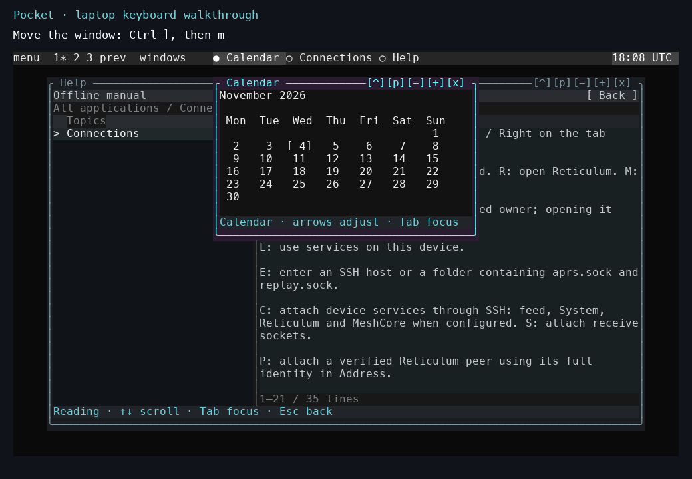

# Get Pocket running on a laptop

Pocket requires **Python 3.11 or newer**, **Make**, and a UTF-8 terminal on macOS or Linux. Use your existing Python environment.

## 1. Download Pocket

Choose either the ZIP download or Git. Both contain the `pocket` directory used in the next step.

### Download a ZIP

[Download the source ZIP](https://github.com/gordol/n810-revival/archive/refs/heads/main.zip) and save it in your Downloads folder. Extract it with your file manager. The extracted directory is named `n810-revival-main`.

Open a terminal and enter Pocket's directory:

```sh
cd ~/Downloads/n810-revival-main/pocket
```

If you extracted the archive elsewhere, use that location in the `cd` command. You should now be in the directory containing `Makefile`, `shell`, and `tests`.

### Clone with Git

If you use Git, run these commands from the directory where you keep source projects:

```sh
git clone https://github.com/gordol/n810-revival.git
cd n810-revival/pocket
```

The [repository](https://github.com/gordol/n810-revival) contains the application source, platform work, tests, and documentation.

## 2. Run Pocket

From the `pocket` directory, run:

```sh
make
```

Make launches the normal Pocket desktop. Keep the source directory for future launches.

On the first run, Pocket creates its default session and opens **Connections**. The top bar lists the open window, and its bright border shows that it has focus. Later launches restore the saved session.



*Actual terminal screenshot from 5 November 2026. Connections shows local system services and the availability of the feed, Reticulum, and MeshCore. Window placement and available services depend on your terminal size and local setup.*

## 3. Open Help and Calendar

1. Press **Ctrl-]**, then **comma**, to open the application menu.
2. Type **Help** and press **Enter**. Help opens in **Reading** with instructions for the previously focused application.
3. Press **Esc** twice to reach the application list. Press **Home** to select **Desktop**, then **Enter** to open its topics.
4. Use **Up/Down** to select a topic; its text appears in the preview. Press **Tab** to focus **Reading**, where **Up/Down** scrolls the text. **Tab** switches back to **Topics**.
5. With Help still focused, press **Ctrl-F**, type **pairing**, and press **Tab** to focus the search results. Use **Up/Down** to select a result and **Enter** to open it. **Esc** cancels an unfinished search.
6. Press **Ctrl-]**, then **comma**, again. Type **Calendar** and press **Enter**.
7. Press **F6** to switch between open windows. **Shift-F6** moves in the reverse direction.



*An example after opening and arranging Calendar and Help, captured on 4 November 2026. Calendar has focus.*

Ctrl-] switches between application input and window-manager commands. The [window-controls tutorial](laptop-tour.md) covers moving, resizing, and maximizing windows. The [overview tutorial](overview-and-backgrounds.md) introduces desktop previews and animated backgrounds.

Tab changes the focused pane directly. Enter opens a selected application, topic, or search result.

## 4. Quit and return

Press **Ctrl-]**, followed by **q**, to quit. To return, open a terminal in the same `pocket` directory and run:

```sh
make
```

Pocket restores your saved settings and application state. These live in `~/.local/state/pocket/default`, or `$XDG_STATE_HOME/pocket/default` if you set `XDG_STATE_HOME`.

## If startup fails

| Symptom | What to do |
|---|---|
| Make reports that `pocket` does not exist | Enter the extracted or cloned `pocket` directory and use `make`. |
| Make reports no makefile found | Check your directory with `pwd` and `ls`. The Pocket directory contains `Makefile`, `shell`, and `tests`. |
| You have several Python versions installed | Select the one to use, for example `make PYTHON=python3.13`. |

## Continue from here

The [installation reference](../pocket/install.md) covers optional native components and service dependencies. Use the [SSH guide](../how-to/ssh.md) to connect an existing tablet installation, or the [APRS demo guide](../how-to/aprs-demo.md) to build the offline maps and explore the fictional packet examples. The [kernel build guide](../how-to/build-kernel.md) covers building the N810 kernel.
