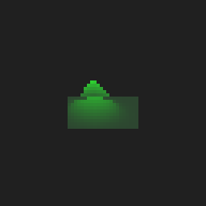
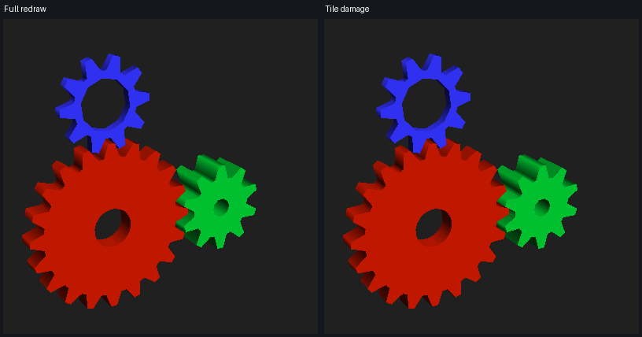

# N810 tile damage in QEMU

A 64 × 64 synthetic surface contains a triangle in a moving 16 × 16 viewport. Two words of an 80-word PowerVR MBX stream update its position. The full and partial paths both send all 80 words. The partial path selects the union of tiles touched by the old and new viewports, including the area uncovered by the move.


November 22, 2026. The left panel shows pixels read from the emulated framebuffer, enlarged 3×. The right panel outlines selected 16 × 16 tiles. The GIF holds each position for 450 ms for inspection.

| QEMU render-kick timing | Median CPU time |
| --- | ---: |
| Full redraw | 1.330 ms |
| Partial redraw, 2–5 of 16 tiles selected | 0.516 ms |

The ratio of medians is **2.58×** (61% less QEMU process CPU time). Each of seven moves ran four paired trials, alternating order. For each trial the full and partial 4,096-pixel framebuffers matched byte-for-byte, and their RGB output matched the standalone model. The cached stream matched the rebuilt stream for every position. [All 28 pairs in microseconds](measurements.csv)

The host was an x86-64 Intel Xeon Platinum 8573C with host frequency unmanaged. The benchmark launches a fresh N810 board for each render, holds the emulated ARM CPU paused, preloads prior pixels outside the selected tiles and initializes the selected tiles to the background. It times the single render-kick MMIO write using QEMU's process CPU clock. Board setup, background initialization, region selection, command preparation, panel transfers, and LCD timing are outside the measurement. The pinned example uses the model's permissive MMU and free-list setup.

This prototype exercises command reuse and tile damage with a model-native command stream. Pocket's encoder also emits a multi-section VGP setup command that this emulator version rejects. The effect of tile damage on Pocket FPS, device energy consumption and end-to-end drag latency remains unmeasured.

## Synthetic hill replay



On November 23, 2026, the benchmark generated one smooth hill on a 9 × 9 grid using a Gaussian function. It used Pocket’s `HeightField.mesh()` helper to triangulate those 81 invented elevations. Both paths replayed the resulting 128 triangles, the same four camera updates and the same model-native commands on a 64 × 64 framebuffer. The rotating hill fits inside four central tiles throughout. Full redraw selected all 16 tiles. Damage redraw selected four and preserved the preceding frame outside them. Every paired framebuffer matched byte-for-byte and matched the standalone model in RGB. The GIF enlarges the QEMU pixels 4× and holds each view for 350 ms.

| Same Xeon Platinum 8573C host, QEMU and harness pinned to logical CPU 2 | Full redraw | Tile damage |
| --- | ---: | ---: |
| Median QEMU CPU time for the render command | 3.651 ms | 2.927 ms |
| Wall time for 32 frame replays | 7.511 s | 7.488 s |
| Frame replays per wall-clock second | 4.26 | 4.27 |

The wall timer includes QEMU launch and teardown per frame, qtest communication, framebuffer initialization or preservation, command submission and pixel readback. Mesh generation and capture occur before either timer. Both paths use the same QEMU binary with the emulated ARM paused and the host clock frequency unmanaged. Measuring interactive Pocket FPS still requires running the application's native command stream.

Each run alternated order over four paired trials per camera update. The table pools all 32 pairs. [Raw measurements](terrain-measurements.csv)

Use the Linux dependencies and pinned upstream revision below. Choose an available logical CPU and run the following command twice for two independent sets of 16 pairs, changing the output filename for the second set. Each invocation also writes the corresponding framebuffer GIF beside the CSV.

```sh
taskset -c 2 python3 terrain_damage.py /path/to/revive-n8x0 /path/to/qemu-system-arm /tmp/terrain-run1.csv
```

## Pocket’s Tahoma scene

[](../../../../docs/assets/demos/terrain-day.mp4)

This archival laptop recording shows Pocket rendering scenery from USGS elevations with vegetation, sky and lighting. A same-host tile-damage comparison for this scene remains outstanding.

## Reproduce the QEMU benchmark

Use Linux, a C compiler, Make, Python 3 and Pillow. Build QEMU 9.1.3 for arm-softmmu using the pinned project's MBX device installation and build instructions. [Carsten Munk's N810 QEMU build](https://github.com/thehumanweb/revive-n8x0/blob/7629d71ca775283248a48729fa6cca18ceb01520/README.md#L194-L200)

From this experiment directory, run:

```sh
python3 measure.py /path/to/revive-n8x0 /path/to/qemu-system-arm /tmp/n810-tile-results
```

Use revive-n8x0 commit `7629d71ca775283248a48729fa6cca18ceb01520` for both the source argument and the QEMU build. The test instruments the upstream triangle example in a temporary directory, builds the host model in the supplied checkout, and writes the GIF and CSV under the output directory.

## Spinning glxgears



Debian glxgears (mesa-utils-bin 8.5.0-1, amd64) ran at 400 × 400 under Xvfb with Mesa llvmpipe. OpenGL feedback recorded six successive frames of transformed geometry and lit vertex colors. QEMU’s N810 MBX model rasterized each capture at the same 400 × 400 resolution. The GIF displays each view at one image pixel per framebuffer pixel and holds each frame for 400 ms.

| 400 × 400 QEMU replay | Full redraw | Tile damage |
| --- | ---: | ---: |
| Selected visible tiles | 625 | 267–272 |
| Median QEMU CPU time per render command | 176.71 ms | 151.57 ms |
| Complete frame replays per wall-clock second | 1.73 | 1.67 |

All 20 matched pairs produced identical 160,000-pixel framebuffers. Each RGB frame also matched the standalone MBX model. Damage covered the union of old and new projected triangle bounds, expanded by one pixel for rounding. Five transitions each ran four alternating-order trials on November 23 on a Xeon Platinum 8573C pinned to logical CPU 2 with unmanaged clocks. Wall time includes fresh QEMU startup, framebuffer preparation, command transfer, readback and shutdown. Interactive application FPS on the tablet remains unmeasured. [400 × 400 samples](spinning-gears-400.csv)

The earlier 64 × 64 run used the same captures and enlarged each output pixel 3×. Add `--size 64` to reproduce it. [Earlier GIF](../../../../docs/assets/demos/qemu-spinning-gears.gif) · [64 × 64 samples](spinning-gears.csv)

Use the pinned emulator and dependencies above. In an empty working directory with a GLX display, compile the capture hook against desktop GL headers, run glxgears, and replay the six feedback files written in that directory. Capture timing determines the angles. Replay uses the same files for both paths.

```sh
exp=/path/to/n810-revival/graphics/mbx/experiments/qemu-tile-damage
cc -shared -fPIC "$exp/gears-feedback.c" -o feedback.so -ldl
LIBGL_ALWAYS_SOFTWARE=1 LD_PRELOAD="$PWD/feedback.so" glxgears -geometry 400x400
taskset -c 2 python3 "$exp/gears_replay.py" /path/to/revive-n8x0 /path/to/qemu-system-arm "$PWD"
```
