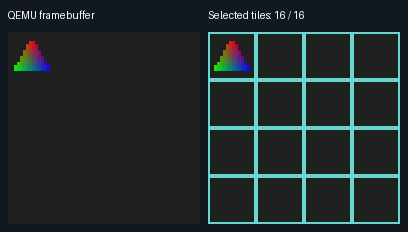
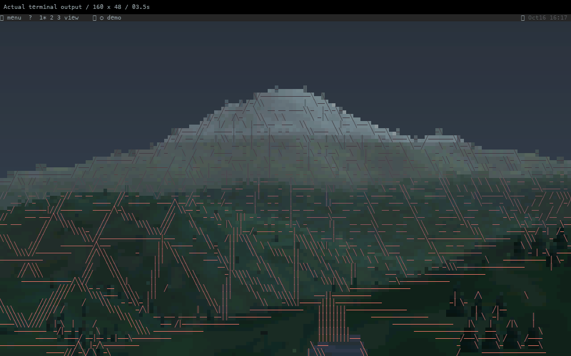
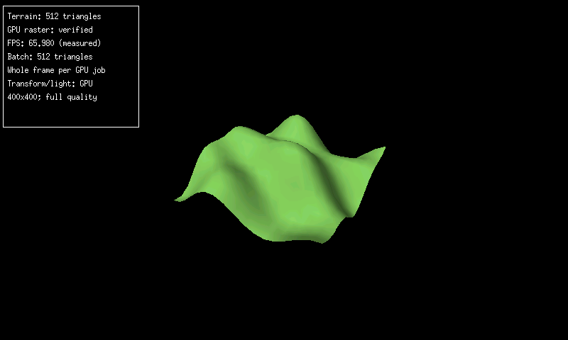

# N810 tile damage in QEMU

A 64 × 64 synthetic surface contains a triangle in a moving 16 × 16 viewport. Two words of an 80-word PowerVR MBX stream update its position. The full and partial paths both send all 80 words. The partial path selects the union of tiles touched by the old and new viewports, including the area uncovered by the move.



November 22, 2026. The left panel shows pixels read from the emulated framebuffer, enlarged 3×. The right panel outlines selected 16 × 16 tiles. The GIF holds each position for 450 ms for inspection.

| QEMU render-kick timing | Median CPU time |
| --- | ---: |
| Full redraw | 1.330 ms |
| Partial redraw, 2–5 of 16 tiles selected | 0.516 ms |

The ratio of medians is **2.58×** (61% less QEMU process CPU time). Each of seven moves ran four paired trials, alternating order. For each trial the full and partial 4,096-pixel framebuffers matched byte-for-byte, and their RGB output matched the standalone model. The cached stream matched the rebuilt stream for every position. [All 28 pairs in microseconds](measurements.csv)

The host was an x86-64 Intel Xeon Platinum 8573C with host frequency unmanaged. The benchmark launches a fresh N810 board for each render, holds the emulated ARM CPU paused, preloads prior pixels outside the selected tiles and initializes the selected tiles to the background. It times the single render-kick MMIO write using QEMU's process CPU clock. Board setup, background initialization, region selection, command preparation, panel transfers, and LCD timing are outside the measurement. The pinned example uses the model's permissive MMU and free-list setup.

This prototype exercises command reuse and tile damage with a model-native command stream. Pocket's encoder also emits a multi-section VGP setup command that this emulator version rejects. The effect of tile damage on Pocket FPS, device energy consumption and end-to-end drag latency remains unmeasured.

## Pocket terrain

[](../../../../docs/assets/demos/terrain-day.mp4)

The eight-second laptop recording shows Pocket constructing its Tahoma scene from real elevation data. The offline benchmark uses a generated hill so it runs without downloading the Tahoma dataset.

On November 23, 2026, Pocket’s terminal renderer produced **12.18 FPS** (median of five runs) on the Intel Xeon Platinum 8573C host with unmanaged clocks and Python 3.12.14. Each fresh process warmed one 80 × 24 cell frame, then advanced scene time by 120 seconds for each of 24 frames with a fixed camera. The measured wall time includes lighting updates, cell composition and ANSI generation. All 24 frames changed cells in every run. Startup, terminal transport and display are outside the timer.

| Run | Seconds for 24 frames | Frames/s |
| --- | ---: | ---: |
| 1 | 1.768 | 13.57 |
| 2 | 1.970 | 12.18 |
| 3 | 2.079 | 11.55 |
| 4 | 1.993 | 12.04 |
| 5 | 1.814 | 13.23 |

Run `python3 pocket_terrain.py` from this directory. This exercises Pocket’s host CPU path independently of the QEMU tile selection experiment.



The November 10 physical N810 test ran a separate 512-triangle rotating heightfield at 400 × 400. It averaged **60.964 completed renders/s** on the 330 MHz kernel and **71.668** on the 480 MHz kernel with the divider fix. The latter sample ran for 33.53 s and recorded about 25.77 display-transfer interrupts/s. The overlay shows one interval within that sample. [Hardware measurements and conditions](../../../../docs/posts/2026-11-10-gpu-residency-and-480mhz.md)

## Reproduce the QEMU benchmark

Use Linux, a C compiler, Make, Python 3 and Pillow. Build QEMU 9.1.3 for arm-softmmu using the pinned project's MBX device installation and build instructions. [Carsten Munk's N810 QEMU build](https://github.com/thehumanweb/revive-n8x0/blob/7629d71ca775283248a48729fa6cca18ceb01520/README.md#L194-L200)

From this experiment directory, run:

```sh
python3 measure.py /path/to/revive-n8x0 /path/to/qemu-system-arm /tmp/n810-tile-results
```

Use revive-n8x0 commit `7629d71ca775283248a48729fa6cca18ceb01520` for both the source argument and the QEMU build. The test instruments the upstream triangle example in a temporary directory, builds the host model in the supplied checkout, and writes the GIF and CSV under the output directory.
