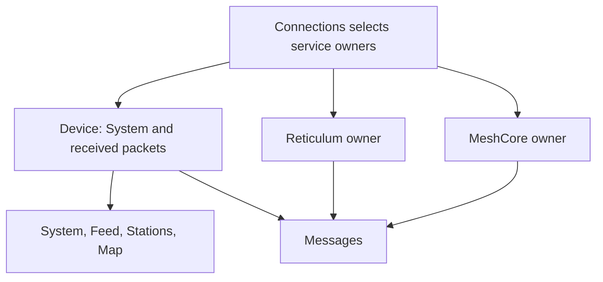

# Apps and services

See [Keyboard navigation](navigation.md) for the shared focus and tab-strip keys.

## Choose a source

Open **Connections**. The **Device** tab selects the device supplying System
telemetry and received packets. Local services attach automatically after launch.
To use another device, enter its address and choose **Connect SSH** or
**Connect peer**. Peer attachment requires a verified contact and a Device read
grant from that device; see [Connections](connections.md).

The service rows open System, Radio Feed, Reticulum, or Messages. Each row shows
availability and the selected owner. Opening an app does not connect a radio,
share a service, or send a message.

Use the **Reticulum** or **MeshCore** tab to select an independent owner. Each tab
keeps its own address. This permits, for example, a Nokia packet feed and a local
MeshCore companion. Disconnecting a device releases its attached owners while
preserving an owner selected independently afterward.

In an app's Settings, activate a receive, Reticulum, or MeshCore service entry to
open its Connections controls. An available provider is a local client binding;
check Connections for the owner's live availability.

*Applications use the selected owners. Each owner reports its own availability and connection state.*

## App sources

| App | Source and operation |
| --- | --- |
| System | Selected device telemetry; local observations when using this device |
| Radio Feed, Heard, Last heard | Selected receive source and retained observations |
| Stations, Station Map | Local Directory projection of received observations and installed map data |
| Services, Nets | Receive-derived information and retained schedules; these are not the device-service catalogue |
| Walk | Retained walk journals; active probing is a separate operation |
| Messages | Receive-derived messages plus independently selected Reticulum and MeshCore owners |
| Reticulum | Selected Reticulum owner; interface activation and sharing grants are explicit |
| Bluetooth, Radio, Radio Manager | Existing radio controls and owner state; a remote feed alone does not grant every hardware command |
| Reader, Library | Local document stores and configured content sources |
| Workbench, CW, Audio Monitor | Local processing or explicitly configured audio inputs |
| Terminal | Local shell process |
| Scenery and graphics demos | Local rendering; no remote service required |

Map Library, Winlink, and hardware experiments have separate integration and
acceptance requirements. Their presence in the source tree does not mean they
are available as shared device services.

## If a service is unavailable

1. Read the owner shown in Connections. Confirm that it is the device you intend.
2. For the device feed or System, check the Device attachment and its error.
3. For Reticulum or MeshCore, select that owner's tab. Attach its local
   configuration or existing socket; open its app to operate the radio.
4. For a remote Reticulum device, confirm the contact key, carrier connection,
   and grants on the supplying device. Attachment does not grant access back.

Retained packets can remain visible after disconnection. Their timestamps are
observations, not proof that a live radio link is working.

## MeshCore through an HTIT hub

On the N810, pair the Classic HTIT hub with the tablet first. In **Messages**,
switch **Protocol** to **MeshCore** and choose **Companions**. Select the
advertised radio by name and address with the touchscreen or the arrow keys
and Enter. If prompted, enter the companion’s six-digit BLE PIN on the tablet.
After pairing, return to Messages and choose **Connect** to sync the selected
companion. To pair another companion, disconnect the active session first.

For manual setup, a local MeshCore selection can use an explicit hub URI in `port`:
`htit://CLASSIC_MAC/SPP_CHANNEL/BLE_MAC/ADDRESS_TYPE`, for example
`htit://02:00:00:00:00:01/1/02:00:00:00:00:02/1` using fictional example addresses. Replace them with the paired hub and companion addresses.
This requires a Linux host with Bluetooth RFCOMM, the optional pinned MeshCore
runtime, and both Bluetooth bonds already established. No PIN belongs in the URI.

The Messages app's MeshCore **Connect** action starts its bridge, connects BLE,
and syncs contacts and configured channels. **Disconnect** closes that bridge.
Shell launch alone does not connect the radio. Loss of the owner closes the
bridge's parent pipe, ending its session; commands are never replayed.

The list opens on contacts and repeaters. Press **G** or choose **Channels**
to see channel conversations. Choose **Contacts** to switch back. Use **B**
for the previous page and **N** for the next page of 32 contacts. Contact sync allows 60 seconds before failing.

After setup Pocket automatically pulls pending messages from the companion.
This consumes their copies in the radio's receive queue. Each received message
is committed to the private `messages.sqlite3` archive in the configured owner
state directory before Pocket requests the next one. The TUI shows the latest
32 messages; older messages remain in that archive. No LoRa test messages are
sent as part of connecting.

If archive storage fails, automatic retrieval stops and the connection closes;
the unsaved message is retained in owner memory for a manual reconnect/save
attempt. MeshCore provides no transactional acknowledge-after-disk-write command,
so a power failure between radio dequeue and local commit can still lose that
in-flight message. The hub itself is a transport and does not maintain a mailbox.

## Downloading UV-PRO memories

Open **Radio Manager → Banks** while the radio is connected. On the paired tablet, **a Download all banks** pauses reception, reads every bank into one backup, restores the original bank and settings, and reconnects reception. Automatic location beaconing must be off for bank switching. Press **c** for **Download current bank** to save every slot in the receive bank and list the names of the other banks. A row marked **name only** has no saved channel contents in this download. Press **d** for **Download selected**. Pocket checks that the selected bank is active before reading channels. A download fails if the final active bank differs from the starting bank. Opening a saved bank displays its memories. Press **p** to review a copy for a local draft.

Open **Settings**, select **Refresh from radio**, then select a reported general or APRS beacon field with the arrow keys and press Enter. Tapping a field also opens its editor. Enter applies the value and Esc cancels the edit. Pocket reads the current settings before applying a change, preserves the other fields, and checks the full settings block afterward. A stale value requires a refresh. Hardware-specific controls outside those two settings blocks, including programmable buttons, use separate radio commands.
