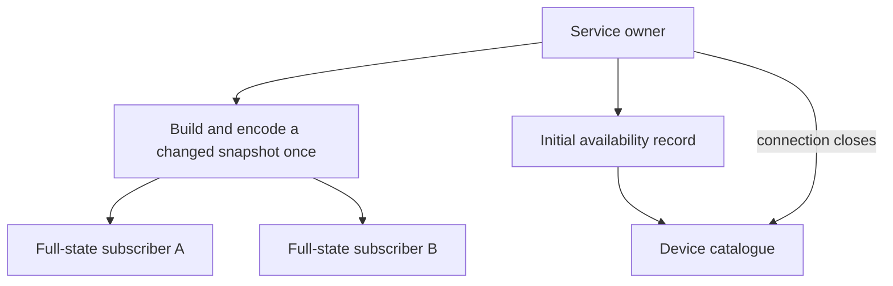

# Publishing shared service state

A service owner distributes its state to desktop clients and reports its
availability to the device catalogue. Full desktop views need the state;
the catalogue needs to know whether the service endpoint remains available.

*Full-state clients receive the encoded update. The catalogue keeps an availability subscription open and observes its closure.*

The shared owner server builds and encodes one snapshot frame per broadcast, then queues those immutable bytes for each full-state subscriber. MeshCore supplies its already bounded frame, so the size check and publication share one encode. Other owners keep their ordinary snapshot method. This avoids an unbounded cache and preserves the existing 32 KiB frame, eight-client and two-frame output-queue limits. Slow clients still disconnect at the queue limit.

A worker completion that leaves the owner revision unchanged does not republish the full state. A completion that changes the revision still publishes. The broadcast records the revision observed before encoding so a concurrent later revision cannot be marked as already published accidentally.

The device catalog needs management endpoint availability from its optional local owners. It now requests a subscription with `scope: availability`: one small record establishes reachability and the connection remains open until EOF or cancellation. It receives no contact, message, radio or bridge status updates. Ordinary UI clients retain full-state subscriptions. Availability refers to the owner service, not a ready radio, verified peer, or delivered message.

Managed startup still probes the complete owner snapshot and validates the selected station, device and trust settings before accepting the availability stream. Endpoint device/inode/ctime identity remains checked. EOF follows the existing shared idle-owner recovery path; no action is replayed. An older owner that ignores the scope returns its regular snapshot and receives the existing per-snapshot identity validation. No heartbeat polling or new retry timer is introduced.

Local verification uses actual Unix sockets and radio-free fixture processes. Three full subscribers receive the same 8 KiB update with one frame build; an availability subscriber receives only its initial small record and detects EOF on owner exit. An unchanged asynchronous completion produces no state update, while a changed revision does. MeshCore checks confirm one encode for an ordinary frame and preserve trimming when a frame would exceed its bound. Shared-owner tests confirm availability startup validation and EOF recovery without actions. The affected publication, transport, selection, recovery and lazy-startup suites pass 45 checks; four additional MeshCore bridge/history checks pass and eight optional-client checks skip without that dependency.

These measurements establish less serialization and catalog decoding work; they do not establish a live Nokia CPU reduction. The device catalog still carries receive snapshots as well as five-second telemetry samples. The receive source can pull snapshots up to twice per second for packet lines, so client work can exceed the MeshCore status cadence. Measuring live per-source frame rates remains necessary before attributing all observed CPU usage to a particular stream. No codec algorithm, radio cadence, desktop scheduler or physical-device state was changed in this work.
