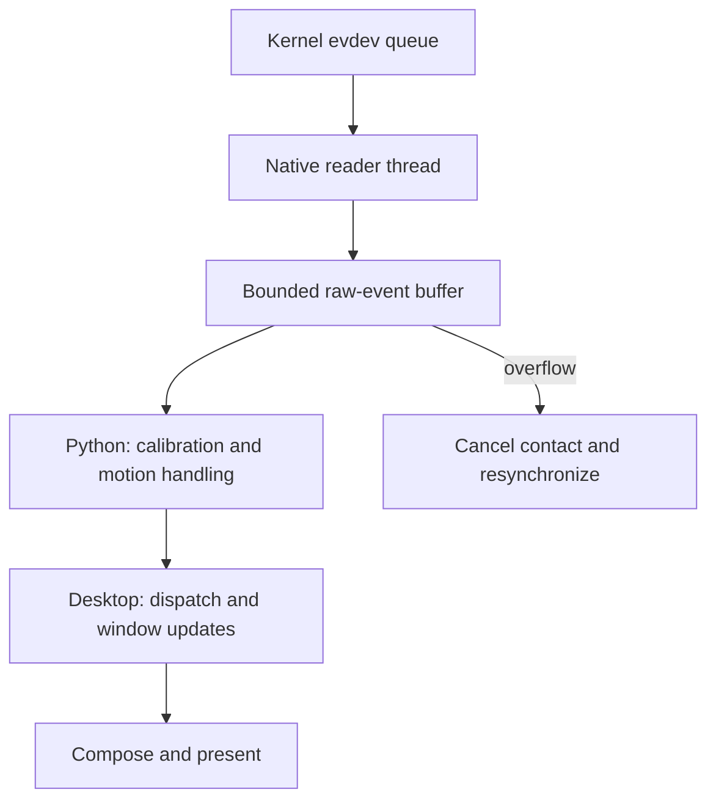

# Touch acquisition under rendering load

The N810 uses one process-owned touch source. A native reader thread drains its
nonblocking evdev descriptor without holding the Python GIL. It retains up to
4096 raw input records (64 KiB on the Nokia) and wakes the existing Python worker
through a nonblocking pipe. Python still owns device validation, calibration,
coordinate mapping, motion coalescing and the existing MessagePack handoff.
Presses, releases and source timestamps retain their order. The queue buffers
real input while the Python worker is occupied.

The urgent read and the visible response are separate stages. Buffering can
preserve input during a stall; the desktop must still process and present it.
The [reader adapter](../shell/touch_evdev.py) and [worker](../shell/touch_process_worker.py)
show where those responsibilities meet.

The queue is bounded. If it overflows, the reader reports loss explicitly and
uses the existing cancel/resynchronization path; it does not silently drop a
press or release. Cancellation and viewport changes discard old queued contacts
before rearming. Device disconnects propagate as errors. Shutdown wakes and joins
the native thread before closing its descriptors. The direct Python acquisition
path remains available when no native library is selected.

This addresses a reproduced failure in release b04f01cf7601 with Balanced Flux
and Connections open. A physical drag/resize test recorded five new SYN_DROPPED
notifications. The first two appeared in an interval containing 228 new major
page faults in the touch worker, but another two-drop interval had no new major
faults. Paging is therefore a contributing suspect, not an explanation of every
loss. The old reader already ran in its own process, but parsing, calibration,
Python execution and paging still occurred between reads of the small kernel
queue. The native thread separates that urgent read from those operations.

Diagnostics distinguish the reader (`native-buffered` or `python`), cumulative
native reads, and native-buffer overflows. Existing SYN_DROPPED/resync/cancel
counters remain visible. The process snapshot is still startup-or-last-active-
batch data, not a continuously refreshed physical contact state; a stale
`pressed` value alone does not prove a stuck contact.

Local tests cover ordering while Python holds the GIL, bounded overflow,
disconnect, idle shutdown, cancellation and resynchronization. The initial five
native-reader tests and three worker/trace tests passed on the physical Nokia.
All six native-reader tests, including the final cancellation boundary, then
passed against the installed ARM library in 2.341 seconds. The final clean
release ran 448 tests successfully with 9 skips. Release 1eff54047718 passed
post-install checks for saved layout/preferences, fresh shared telemetry, both
radio owners, all 200 retained packets and one desktop/touch worker. The subsequent physical test collected 107 samples over
222.681 seconds, all Balanced and connected, with 2,036 emitted reports and
77 mapped events. It recorded zero new SYN_DROPPED, resyncs, cancellations or
native overflows; the final contact was released. The worker incurred 285 major
faults without losing input. The user nevertheless reported substantial lag,
especially switching to an empty desktop and back, so overall responsiveness
was not accepted. Active swap was zram; SD swap was unused. Major faults alone
do not identify storage reads or prove the cause of any stall. The first
automatic health discovery timed out; a direct desktop query succeeded and a
subsequent full check under the desktop owner passed. The timeout is retained
as a verification limitation rather than attributed to a proven runtime fault.

The next performance target was the time between a retained event and its
visible response. That includes desktop dispatch, scene work, and presentation;
the [rendering explanation](../../docs/explanation/rendering.md) follows those stages.
